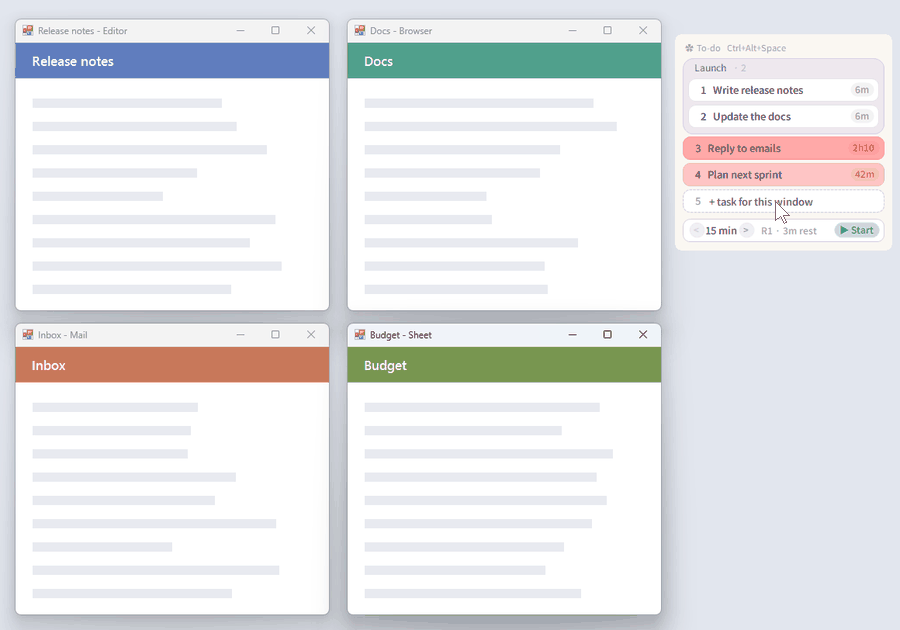

# ADHDTimer

**English** | [한국어](README_ko.md)

A tiny always-on-top **task queue + focus timer** widget.
It sits in the top-right corner of the screen, shows what you're working on and what has been waiting the longest, and walks you through focus/break cycles.



<sub>Demo with sample data on Windows. The focus run is the 10-second test mode (Ctrl+click ▶ Start).</sub>

Runs on **Windows** (`PQ.cs`, a single-file C# WinForms app) and **macOS** (`mac/`, a native Swift/AppKit app).

The UI is available in **English** and **Korean**. It follows the system display language by default; switch any time from the right-click menu → **Language**.

## Features

### Task queue
- Type a task in the input card and it gets linked to the **window you're in**. While you're in that window the task shows as *working*.
- Tasks you haven't touched in a while slowly turn red.
- Notes, drag to reorder, adjustable opacity.
- Drop a task onto another task to make a **group** (a rounded section). Moving between the windows of a group counts as the same task.
- Click the current task again to rename it; click a section header to rename the group.

### Focus timer
- Each task has rounds: **round 1: 15 min focus / 3 min break → round 2: 30 / 5 → round 3+: 60 / 15**. Use `<` `>` to change the round.
- While focusing, other tasks don't age.
- Switching to an unrelated window shows a centered **1-minute grace timer**; come back within a minute and the session continues.
- When a session ends, a **full-screen break** covers the screen.
  - `+5 min focus`: keep going on the same task for 5 more minutes (the bar keeps the time already focused), then the break comes back.
  - `Rest in background`: hide the break screen; a centered alert appears **10 seconds** before the break ends.
  - In an emergency, double-click the text at the bottom to skip the break.

### Log and stats
- Every focus session is appended to `focus_log.csv` (see below).
- Right-click → **Stats**: total focus, sessions, completion rate, focus per day / per hour, focus by task, and recent sessions, for today / 7 days / 30 days / all time.
- `PQ.exe --stats` (Windows) or `FocusQueue.app/Contents/MacOS/FocusQueue --stats` (macOS) opens the stats window directly.

## Build (Windows)

Only needs `csc.exe`, which ships with .NET Framework 4. Nothing to install.

```bat
build.bat
```

This produces `PQ.exe`. Hotkey: `Ctrl+Alt+Space`. Launching it again while it's running brings the widget back on screen.

## Build (macOS)

Needs macOS 12 or later and the Swift toolchain (Xcode, or `xcode-select --install`). There is no Xcode project.

```bash
mac/build.sh
```

This produces `mac/build/FocusQueue.app` (universal, no Dock icon). Move it to `/Applications` and open it. `mac/build.sh --run` builds and restarts a running widget; your task queue is backed up first and never deleted.

- Hotkey: `Ctrl+Option+Space`. Opening the app again while it's running brings the widget back on screen.
- To link tasks to individual windows, allow FocusQueue in **System Settings → Privacy & Security → Accessibility**. Without it, tasks are linked per app, and the widget shows a notice you can click. The build is ad-hoc signed, so you may need to allow it again after rebuilding.
- Differences from Windows: `Option+click` on **▶ Start** runs a 10-second test session (`Ctrl+click` on Windows), `Ctrl+click` opens the right-click menu, `Cmd+click` only selects, and `Delete` marks the selected task done.

## Data

All data stays on your machine, in `%APPDATA%\ADHD-PQ\` (Windows) or `~/Library/Application Support/ADHD-PQ/` (macOS). Nothing is sent anywhere.
On Windows, `PQ.exe --data <folder>` runs a separate instance that keeps its data in another folder (handy for a portable copy or a demo).

| File | Contents |
|---|---|
| `items.tsv` | the task queue (linked windows, rounds, groups) |
| `groups.tsv` | group names |
| `focus_log.csv` | focus log (UTF-8 with BOM, opens in Excel) |
| `opacity.txt`, `lang.txt` | settings |

`focus_log.csv` columns:

| column | meaning |
|---|---|
| `start`, `end` | `yyyy-MM-dd HH:mm:ss`, local time |
| `minutes` | focused minutes, excluding time spent away |
| `task`, `group` | task and group name |
| `round` | 1, 2, 3 |
| `planned_min` | planned length of the segment |
| `kind` | `focus` or `extension` (+5 min) |
| `outcome` | `done`, `stopped`, `left` (didn't come back within 1 min), `quit` (widget closed) |

Segments shorter than 30 seconds are not logged.

On macOS the files have the same format. In `items.tsv` the window column holds a `CGWindowID` (`0` = the whole app) and the process column holds the app's bundle identifier. Each launch copies `items.tsv` to `items.bak.tsv` before anything is written.
