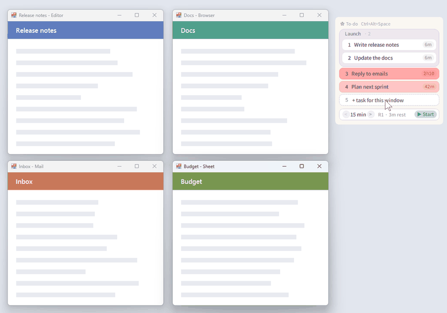

# ADHDTimer

[English](README.md) | **한국어**

항상 위에 떠 있는 작은 **할 일 큐 + 집중 타이머** 위젯입니다.
화면 우측 상단에 떠서 지금 하고 있는 일과 가장 오래 기다린 일을 보여주고, 집중/휴식 사이클을 이끌어 줍니다.



<sub>예시 데이터로 찍은 데모입니다. 집중은 10초 테스트 모드(Ctrl+클릭 ▶ 시작)입니다.</sub>

> 현재는 **Windows** 버전만 있습니다(`PQ.cs`, 단일 파일 C# WinForms 앱). macOS 버전은 작업 중입니다.

화면은 **영어**와 **한국어**를 지원합니다. 기본값은 시스템 표시 언어를 따르고, 우클릭 메뉴 → **언어**에서 언제든 바꿀 수 있습니다.

## 기능

### 할 일 큐
- 입력 카드에 할 일을 적으면 **지금 보고 있는 창**과 연결됩니다. 그 창에 있는 동안 할 일이 *작업 중*으로 표시됩니다.
- 한동안 손대지 않은 할 일은 점점 빨갛게 변합니다.
- 메모, 드래그로 순서 바꾸기, 투명도 조절.
- 할 일을 다른 할 일 위에 끌어다 놓으면 **묶음**(둥근 섹션)이 됩니다. 묶음 안의 창들 사이를 오가는 것은 같은 작업으로 칩니다.
- 지금 작업 중인 할 일을 한 번 더 클릭하면 이름을 바꿀 수 있고, 섹션 헤더를 클릭하면 묶음 이름을 바꿀 수 있습니다.

### 집중 타이머
- 할 일마다 회차가 있습니다: **1회차 15분 집중 / 3분 휴식 → 2회차 30 / 5 → 3회차부터 60 / 15**. `<` `>`로 회차를 바꿉니다.
- 집중하는 동안 다른 할 일은 시간이 흐르지 않습니다.
- 관련 없는 창으로 넘어가면 화면 가운데에 **1분 유예 타이머**가 뜹니다. 1분 안에 돌아오면 집중이 이어집니다.
- 집중이 끝나면 **전체 화면 휴식**이 화면을 덮습니다.
  - `+5분 더 집중`: 같은 할 일로 5분 더 집중합니다(바에는 이미 집중한 시간이 이어서 쌓임). 끝나면 다시 휴식이 뜹니다.
  - `백그라운드로 쉬기`: 휴식 화면을 숨기고, 휴식이 끝나기 **10초 전**에 가운데에 알림이 뜹니다.
  - 급할 때는 화면 아래쪽 문구를 더블클릭해서 휴식을 건너뛸 수 있습니다.

### 기록과 통계
- 모든 집중 세션이 `focus_log.csv`에 기록됩니다(아래 참고).
- 우클릭 → **통계 보기**: 오늘 / 7일 / 30일 / 전체 기간의 총 집중 시간, 세션 수, 완료율, 일별·시간대별 집중, 할 일별 집중, 최근 세션.
- `PQ.exe --stats`로 통계 창을 바로 열 수 있습니다.

## 빌드 (Windows)

.NET Framework 4에 들어 있는 `csc.exe`만 있으면 됩니다. 따로 설치할 것은 없습니다.

```bat
build.bat
```

`PQ.exe`가 만들어집니다. 단축키는 `Ctrl+Alt+Space`입니다. 실행 중에 한 번 더 실행하면 위젯을 화면으로 다시 불러옵니다.

## 데이터

모든 데이터는 내 컴퓨터의 `%APPDATA%\ADHD-PQ\`에만 저장됩니다. 어디로도 전송되지 않습니다.
`PQ.exe --data <폴더>`로 실행하면 다른 폴더에 데이터를 두는 별도 인스턴스가 뜹니다(휴대용 사본이나 데모용).

| 파일 | 내용 |
|---|---|
| `items.tsv` | 할 일 큐 (연결된 창, 회차, 묶음) |
| `groups.tsv` | 묶음 이름 |
| `focus_log.csv` | 집중 기록 (BOM 포함 UTF-8, 엑셀에서 바로 열림) |
| `opacity.txt`, `lang.txt` | 설정 |

`focus_log.csv` 열 (값은 화면 언어와 상관없이 영어 코드로 저장됩니다):

| 열 | 의미 |
|---|---|
| `start`, `end` | `yyyy-MM-dd HH:mm:ss`, 현지 시각 |
| `minutes` | 집중한 시간(분), 자리를 비운 시간은 제외 |
| `task`, `group` | 할 일과 묶음 이름 |
| `round` | 1, 2, 3 |
| `planned_min` | 계획했던 길이(분) |
| `kind` | `focus`(기본) 또는 `extension`(+5분 연장) |
| `outcome` | `done`(완료), `stopped`(중지), `left`(1분 안에 안 돌아옴), `quit`(위젯 종료) |

30초보다 짧은 집중은 기록하지 않습니다.
